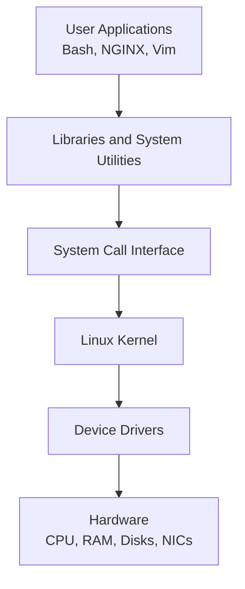
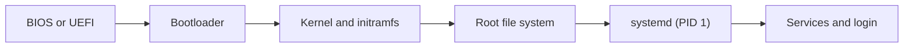

# Linux Architecture — Structured Beginner Notes

A beginner-friendly explanation of how Linux is organized internally, how its main components communicate, and what happens from system startup to command execution.

These notes are suitable for:

- Linux administration practice
- RHCSA revision
- Classroom teaching
- Technical interview preparation

## Table of Contents

- [1. Learning Objectives](#1-learning-objectives)
- [2. Linux Architecture Overview](#2-linux-architecture-overview)
- [3. Hardware Layer](#3-hardware-layer)
- [4. Kernel Space](#4-kernel-space)
- [5. System Calls](#5-system-calls)
- [6. User Space](#6-user-space)
- [7. Shell](#7-shell)
- [8. init and systemd](#8-init-and-systemd)
- [9. Linux Boot Process](#9-linux-boot-process)
- [10. Processes](#10-processes)
- [11. Process States](#11-process-states)
- [12. File-System Architecture](#12-file-system-architecture)
- [13. Useful Inspection Commands](#13-useful-inspection-commands)
- [14. Common Misconceptions](#14-common-misconceptions)
- [15. Interview Questions](#15-interview-questions)
- [16. Quick Revision Summary](#16-quick-revision-summary)

---

## 1. Learning Objectives

After studying these notes, you should be able to explain:

1. The difference between kernel space and user space
2. How applications request services from the kernel
3. The roles of the shell, libraries, services, and `systemd`
4. What happens during the Linux boot process
5. How Linux creates, schedules, and cleans up processes
6. How files and devices fit into Linux architecture

---

## 2. Linux Architecture Overview

Linux is organized into layers. Each layer has a specific responsibility and communicates with the layers around it.



### Main layers

| Layer | Purpose | Examples |
|---|---|---|
| Hardware | Physical or virtual computing resources | CPU, RAM, disks, network interfaces |
| Kernel space | Controls hardware and manages system resources | Scheduler, memory manager, drivers |
| System-call interface | Controlled entry point into the kernel | `open()`, `read()`, `write()`, `fork()` |
| User space | Runs applications and system utilities | Bash, SSH, NGINX, Vim |
| User interface | Accepts instructions from users or other systems | Shell, GUI, API |

### Core principle

User applications do not directly control hardware. They request kernel services through **system calls**, and the kernel performs authorized operations.

This separation improves:

- **Security:** applications have limited privileges
- **Stability:** an application failure normally does not crash the kernel
- **Isolation:** processes have separate virtual address spaces
- **Resource control:** the kernel decides how CPU, memory, and devices are shared

---

## 3. Hardware Layer

The hardware layer contains the resources used by the operating system.

Examples include:

- CPU or virtual CPUs
- Physical memory (RAM)
- Storage devices
- Network interface cards
- Keyboard, mouse, and display
- Virtual devices presented by a hypervisor

Applications normally do not communicate with these devices directly. The kernel uses **device drivers** to control them.

### Useful commands

```bash
lscpu
free -h
lsblk
ip -br addr
lspci
```

---

## 4. Kernel Space

The **kernel** is the core of the Linux operating system. It runs with the highest privilege level and remains active while the system is running.

The Linux kernel is written mainly in C, with architecture-specific and performance-sensitive portions written in assembly and other supported languages.

### Main kernel responsibilities

#### Process management

The kernel:

- Creates and terminates processes
- Schedules processes on available CPUs
- Switches CPU time between processes
- Tracks process IDs and states

#### Memory management

The kernel:

- Allocates and releases memory
- Provides each process with a virtual address space
- Manages paging and swap
- Protects one process's memory from another process

#### Device management

The kernel uses device drivers to communicate with:

- Disks
- Network adapters
- USB devices
- Displays
- Virtual hardware

#### File-system management

The kernel provides a common interface for file systems such as:

- XFS
- ext4
- Btrfs
- NFS
- tmpfs

#### Networking

The kernel implements major networking functions, including:

- TCP/IP
- Routing
- Packet processing
- Network interfaces
- Firewall frameworks such as Netfilter

### Kernel information commands

```bash
uname -r
uname -a
cat /proc/version
lsmod
dmesg | less
```

---

## 5. System Calls

A **system call** is a controlled request from a user-space program to the kernel.

Common system calls include:

| System call | Purpose |
|---|---|
| `open()` | Open a file |
| `read()` | Read data |
| `write()` | Write data |
| `close()` | Close a file descriptor |
| `fork()` | Create a new process |
| `execve()` | Replace a process with a new program |
| `socket()` | Create a network socket |

### Example: reading a file

When you run:

```bash
cat notes.txt
```

The simplified flow is:

1. The shell starts the `cat` program.
2. `cat` requests the kernel to open `notes.txt`.
3. The kernel checks permissions.
4. The file-system and storage layers retrieve the data.
5. The kernel returns the data to `cat`.
6. `cat` writes the data to the terminal.

### Observe system calls

```bash
strace cat /etc/hostname
```

> `strace` may need to be installed separately.

---

## 6. User Space

**User space** is the protected area where ordinary applications, shells, utilities, libraries, and most services run.

Examples include:

- Shells: Bash and Zsh
- Editors: Vim and Nano
- Web servers: NGINX and Apache HTTP Server
- Database servers: MariaDB and PostgreSQL
- Utilities: `ls`, `cp`, `grep`, and `tar`
- Desktop applications: web browsers and file managers

### User-space privileges

User-space programs run under a user identity. Their permissions depend on:

- User ID (UID)
- Group ID (GID)
- File permissions
- Access control lists
- Linux security controls such as SELinux or AppArmor
- Linux capabilities

Root has extensive privileges, but root applications still run in user space unless executing kernel code through an approved interface.

---

## 7. Shell

A **shell** is a command interpreter. It accepts commands, expands variables and wildcards, configures redirection, and starts programs.

Common Linux shells include:

- Bash
- Zsh
- Fish
- Dash

### Example

```bash
ls -lh /var/log
```

Simplified execution flow:

1. Bash reads and parses the command.
2. Bash identifies `ls` as the program.
3. Bash creates a child process.
4. The child executes `ls` with the supplied arguments.
5. The kernel schedules the process on a CPU.
6. `ls` reads directory information through system calls.
7. The output appears in the terminal.
8. `ls` exits, and Bash displays the prompt again.

### Shell versus terminal

| Term | Meaning |
|---|---|
| Terminal | The interface or window used for text input and output |
| Shell | The program that interprets commands |
| Command | An instruction entered into the shell |

---

## 8. init and systemd

The **init system** is the first user-space process started by the kernel. It normally receives **PID 1**.

Most modern enterprise Linux distributions use **systemd**, although some Linux systems use other init systems.

### systemd responsibilities

- Starts services and targets during boot
- Stops services during shutdown
- Tracks service dependencies
- Restarts configured services after failure
- Manages sockets, timers, mounts, and devices
- Collects logs through `systemd-journald`

### Useful systemd commands

```bash
systemctl status ssh
systemctl is-active ssh
systemctl is-enabled ssh
sudo systemctl start nginx
sudo systemctl enable nginx
sudo systemctl enable --now nginx
journalctl -u nginx
```

### Verify PID 1

```bash
ps -p 1 -o pid,comm,args
```

Example output:

```text
PID COMMAND         COMMAND
  1 systemd         /sbin/init
```

> Containers and minimal environments may use a different PID 1 process.

---

## 9. Linux Boot Process

The exact boot process depends on the platform and distribution, but a typical system follows these stages:



### Stage 1: BIOS or UEFI

Firmware initializes hardware and locates a bootable device.

### Stage 2: Bootloader

A bootloader such as GRUB loads the selected Linux kernel and initial RAM file system.

### Stage 3: Kernel and initramfs

The kernel:

- Initializes CPU and memory management
- Detects hardware
- Loads required drivers
- Uses the initramfs to access the real root file system

### Stage 4: Root file system

The kernel mounts the root file system and prepares the user-space environment.

### Stage 5: PID 1

The kernel starts the init system, commonly `systemd`, as PID 1.

### Stage 6: Services and login

`systemd` starts the configured target, services, consoles, and login environment.

### Boot investigation commands

```bash
systemd-analyze
systemd-analyze blame
journalctl -b
cat /proc/cmdline
```

---

## 10. Processes

A **process** is a running instance of a program.

Each process normally has:

- A process ID (PID)
- A parent process ID (PPID)
- A user and group identity
- A virtual address space
- Open file descriptors
- An environment
- A current working directory
- A scheduling state and priority

### Program versus process

| Program | Process |
|---|---|
| Executable code stored on disk | A running instance of that code |
| Passive | Active |
| Example: `/usr/bin/ls` | Example: an executing `ls` process |

### Parent and child processes

A process can create another process. The creator is the **parent**, and the new process is the **child**.

```bash
ps -eo pid,ppid,user,state,comm
```

### Example: running `ls`

1. The shell creates a child process.
2. The child loads and executes the `ls` program.
3. The kernel schedules it on a CPU.
4. `ls` reads directory information.
5. `ls` prints its output and exits.
6. The parent shell collects the child's exit status.

---

## 11. Process States

Linux processes can move between several states.

| Code | State | Meaning |
|---|---|---|
| `R` | Running or runnable | Executing or waiting for CPU time |
| `S` | Interruptible sleep | Waiting for an event; signals can wake it |
| `D` | Uninterruptible sleep | Usually waiting for kernel or I/O activity |
| `T` | Stopped | Paused by a signal or debugger |
| `Z` | Zombie | Finished, but the parent has not collected its status |
| `I` | Idle kernel thread | An idle kernel worker thread |

### View process states

```bash
ps -eo pid,ppid,state,comm
```

### Find zombie processes

```bash
ps -eo pid,ppid,state,comm | awk '$3 == "Z"'
```

### Important zombie-process facts

- A zombie is no longer executing.
- It does not consume CPU time.
- Most of its memory has already been released.
- It retains a small process-table entry containing its PID and exit status.
- The parent process should collect the exit status with a wait operation.
- Many zombies can exhaust available process IDs or process-table capacity.

> Killing a zombie directly does not solve the root problem because it has already exited. Investigate its parent process.

---

## 12. File-System Architecture

Linux presents files and devices through a single directory tree beginning at `/`.

### Important directories

| Directory | Purpose |
|---|---|
| `/` | Root of the directory tree |
| `/boot` | Kernel, initramfs, and bootloader files |
| `/etc` | System configuration |
| `/home` | Regular users' home directories |
| `/root` | Root user's home directory |
| `/var` | Variable data such as logs, caches, and application data |
| `/tmp` | Temporary files |
| `/usr` | Applications, libraries, and shared read-only data |
| `/dev` | Device files |
| `/proc` | Virtual process and kernel information |
| `/sys` | Virtual kernel and device information |
| `/run` | Runtime state since boot |

### “Everything is a file”

This phrase means Linux exposes many resources through file-like interfaces. Examples include:

- Hardware devices under `/dev`
- Process information under `/proc`
- Kernel and device information under `/sys`
- Pipes and sockets used for inter-process communication

It is a useful design principle, but not every Linux object is literally a regular disk file.

---

## 13. Useful Inspection Commands

### Architecture and kernel

```bash
uname -a
uname -r
cat /etc/os-release
lscpu
```

### Processes and resources

```bash
ps aux
ps -ef
top
free -h
uptime
```

### Services and boot

```bash
systemctl --failed
systemctl list-units --type=service
journalctl -b
systemd-analyze
```

### File systems and devices

```bash
lsblk -f
findmnt
df -hT
mount
```

### Networking

```bash
ip -br addr
ip route
ss -lntup
ping -c 4 8.8.8.8
```

---

## 14. Common Misconceptions

### “Applications never communicate with the kernel”

Incorrect. Applications request kernel services through system calls, often through standard libraries.

### “A process always has its own physical RAM”

Not exactly. Each process has a protected **virtual address space**. The kernel maps virtual memory to physical RAM, shared memory, files, or swap as needed.

### “A zombie is still running”

Incorrect. A zombie has finished execution. It remains only because its parent has not collected its exit status.

### “systemd is part of the kernel”

Incorrect. `systemd` is a user-space init and service manager. The kernel starts it as PID 1 on distributions that use it.

### “Root applications run in kernel space”

Incorrect. Root applications normally run in user space with elevated permissions. Kernel space is reserved for kernel code and kernel modules.

---

## 15. Interview Questions

### What is the Linux kernel?

The Linux kernel is the privileged core of the operating system. It manages processes, memory, devices, file systems, networking, and access to hardware.

### What is the difference between kernel space and user space?

Kernel space runs privileged kernel code with direct control over system resources. User space runs applications with restricted access and uses system calls to request kernel services.

### What is a system call?

A system call is a controlled interface through which a user-space process requests a service from the kernel, such as reading a file, creating a process, or opening a network socket.

### What is PID 1?

PID 1 is the first user-space process started by the kernel. On most modern enterprise Linux systems, it is `systemd`.

### What is a zombie process?

A zombie is a process that has finished execution but still has a process-table entry because its parent has not collected its exit status.

### What is the difference between a program and a process?

A program is executable code stored on disk. A process is a running instance of that program with a PID, memory mappings, open files, and execution state.

---

## 16. Quick Revision Summary

- Linux architecture separates hardware, kernel space, system calls, and user space.
- The kernel controls CPU scheduling, memory, devices, file systems, and networking.
- Device drivers allow the kernel to communicate with physical and virtual hardware.
- Applications request kernel services through system calls.
- User-space applications run with a UID, GID, permissions, and security restrictions.
- The shell interprets commands and starts programs.
- `systemd` commonly runs as PID 1 and manages services and boot targets.
- A process is a running program with a PID, PPID, virtual memory, files, and state.
- Zombie processes have exited but still await cleanup by their parent.
- Linux presents files, devices, and kernel information through one directory tree rooted at `/`.

## Recommended Practice

Run these commands in a safe Linux lab and explain the output in your own words:

```bash
uname -a
ps -p 1 -o pid,comm,args
ps -eo pid,ppid,state,comm
free -h
lsblk -f
findmnt
systemctl --failed
journalctl -b -n 20
ip -br addr
ss -lntup
```
