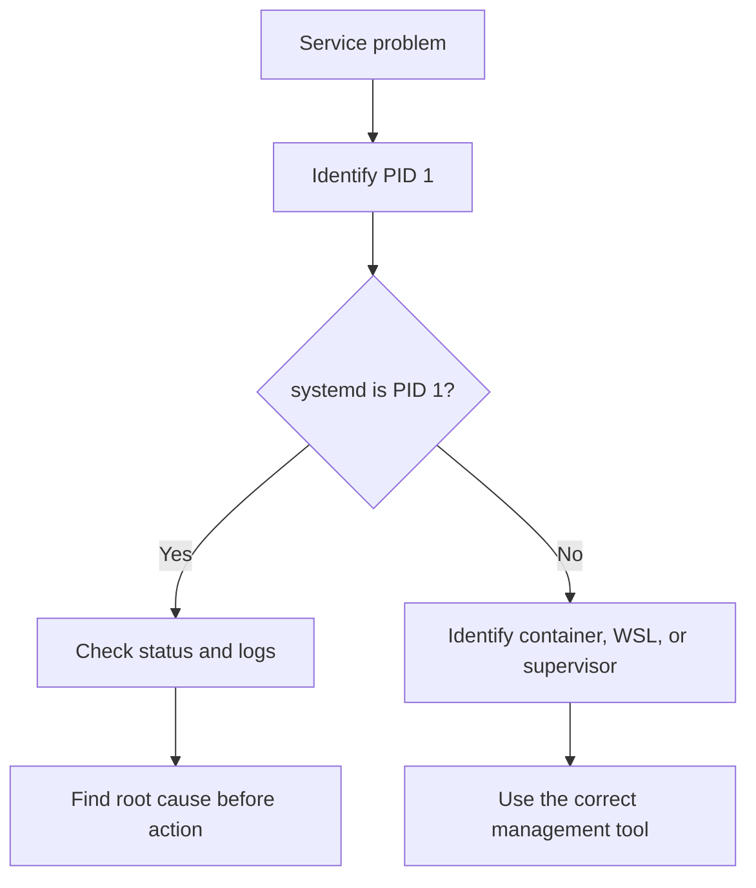

# Day 04 — Linux Processes, Services, and Logs: Hands-On Lab

A structured Linux practice lab for inspecting processes, managing safe test jobs, examining `systemd` services, reading logs, and troubleshooting environments where `systemctl` does not work.

> **Lab safety:** The exercises use harmless `sleep` processes for process-control practice. Do not stop SSH, networking, or other critical services on a remote system.

## Table of Contents

- [1. Learning Objectives](#1-learning-objectives)
- [2. Lab Requirements](#2-lab-requirements)
- [3. Command-Prompt Conventions](#3-command-prompt-conventions)
- [4. Lab 1 — Identify the System](#4-lab-1--identify-the-system)
- [5. Lab 2 — Inspect Processes](#5-lab-2--inspect-processes)
- [6. Lab 3 — Create and Manage a Test Process](#6-lab-3--create-and-manage-a-test-process)
- [7. Lab 4 — Monitor Processes with top](#7-lab-4--monitor-processes-with-top)
- [8. Lab 5 — Understand Process Priority](#8-lab-5--understand-process-priority)
- [9. Lab 6 — Inspect systemd and PID 1](#9-lab-6--inspect-systemd-and-pid-1)
- [10. Lab 7 — Inspect Service Units](#10-lab-7--inspect-service-units)
- [11. Lab 8 — Read Service and Boot Logs](#11-lab-8--read-service-and-boot-logs)
- [12. Lab 9 — Read Distribution Package Logs](#12-lab-9--read-distribution-package-logs)
- [13. Lab 10 — Troubleshoot systemctl Failures](#13-lab-10--troubleshoot-systemctl-failures)
- [14. Troubleshooting Flow](#14-troubleshooting-flow)
- [15. Command Comparison](#15-command-comparison)
- [16. Common Mistakes and Corrections](#16-common-mistakes-and-corrections)
- [17. Practice Questions](#17-practice-questions)
- [18. Lab Completion Checklist](#18-lab-completion-checklist)
- [19. Quick Reference](#19-quick-reference)

---

## 1. Learning Objectives

After completing this lab, you should be able to:

1. Identify the kernel, hostname, architecture, and Linux distribution
2. Display and sort processes
3. Locate a process by name or PID
4. Start, inspect, and terminate a safe background process
5. Interpret key fields from `top`
6. Identify PID 1 and the active init system
7. Distinguish installed service unit files from currently loaded units
8. Check service state without making changes
9. Query current-boot and service-specific logs
10. Troubleshoot a system where `systemctl` cannot connect to `systemd`

---

## 2. Lab Requirements

Recommended environment:

- Ubuntu 24.04, Rocky Linux 9, or a similar distribution
- A regular user account
- `sudo` access for commands that need elevated privileges
- A VM, cloud instance, or WSL distribution with `systemd` enabled

### Check whether required commands exist

```bash
command -v ps
command -v top
command -v pgrep
command -v systemctl
command -v journalctl
```

If a command prints a path, it is available. No output normally means the command is not in your current `PATH`.

---

## 3. Command-Prompt Conventions

Linux documentation commonly uses these prompt symbols:

| Symbol | Meaning |
|---|---|
| `$` | Run as a regular user |
| `#` | Run as root |

Do not type the prompt symbol itself.

Example:

```text
$ uname -a
```

You type only:

```bash
uname -a
```

---

## 4. Lab 1 — Identify the System

### Step 1: Display kernel and host information

```bash
uname -a
```

Example:

```text
Linux lab-server 6.8.0-xx-generic #xx-Ubuntu SMP x86_64 GNU/Linux
```

### Important fields

| Field | Meaning |
|---|---|
| `Linux` | Kernel name |
| `lab-server` | Hostname |
| `6.8.0-xx-generic` | Kernel release |
| `SMP` | Kernel supports symmetric multiprocessing |
| `x86_64` | 64-bit x86 machine architecture |
| `GNU/Linux` | GNU user-space tools running with the Linux kernel |

The exact output varies by distribution, kernel, architecture, and environment.

### Step 2: Display focused information

```bash
uname -r
uname -m
hostname
cat /etc/os-release
```

### What each command shows

| Command | Purpose |
|---|---|
| `uname -r` | Kernel release |
| `uname -m` | Machine architecture |
| `hostname` | System hostname |
| `cat /etc/os-release` | Distribution name and version |

### Verification

Confirm that you can identify:

- Distribution
- Distribution version
- Kernel release
- CPU architecture
- Hostname

---

## 5. Lab 2 — Inspect Processes

### Step 1: Display processes for the current terminal

```bash
ps
```

This normally shows processes associated with the current terminal session.

### Step 2: Display all processes in full format

```bash
ps -ef
```

Important columns:

| Column | Meaning |
|---|---|
| `UID` | Process owner |
| `PID` | Process ID |
| `PPID` | Parent process ID |
| `C` | Processor-utilization value used by this output format |
| `STIME` | Process start time or date |
| `TTY` | Associated terminal |
| `TIME` | Accumulated CPU time |
| `CMD` | Command |

### Step 3: Create a custom process view

```bash
ps -eo pid,ppid,user,state,%mem,%cpu,comm --sort=-%cpu | head
```

### Option breakdown

| Option | Meaning |
|---|---|
| `-e` | Select all processes |
| `-o` | Choose custom output columns |
| `--sort=-%cpu` | Sort by `%CPU` in descending order |
| `head` | Display the first ten lines by default |

> In `ps`, `%CPU` is generally based on CPU time over the process lifetime. Use `top`, `pidstat`, or another monitoring tool when you need repeatedly sampled activity.

### Step 4: Search for a process by name

```bash
pgrep -a bash
```

| Element | Meaning |
|---|---|
| `pgrep` | Find process IDs matching a name or pattern |
| `-a` | Display the PID and full command line |
| `bash` | Pattern to match |

For an exact process-name match:

```bash
pgrep -x -a bash
```

### Verification

```bash
ps -p 1 -o pid,ppid,user,state,comm,args
```

This inspects only PID 1.

---

## 6. Lab 3 — Create and Manage a Test Process

This exercise uses `sleep`, so no production application is affected.

### Step 1: Start a background process

```bash
sleep 300 &
```

The shell normally prints a job number and PID:

```text
[1] 2456
```

- `1` is the shell job number.
- `2456` is an example PID.

### Step 2: Save the PID immediately

```bash
lab_pid=$!
printf 'Lab PID: %s\n' "$lab_pid"
```

`$!` contains the PID of the most recently started background process.

### Step 3: Inspect the job and process

```bash
jobs -l
ps -p "$lab_pid" -o pid,ppid,user,state,etime,cmd
```

Important fields:

| Field | Meaning |
|---|---|
| `STATE` | Current process state |
| `ELAPSED` or `ETIME` | Time since the process started |
| `CMD` | Command line |

### Step 4: Request graceful termination

```bash
kill "$lab_pid"
```

Without another signal, `kill` sends `SIGTERM`. It asks the process to terminate gracefully.

### Step 5: Verify termination

```bash
ps -p "$lab_pid"
```

Expected result:

```text
PID TTY          TIME CMD
```

Only the heading normally remains because the process no longer exists.

### Step 6: Clear the variable

```bash
unset lab_pid
```

### Why not use `kill -9` first?

`kill -9` sends `SIGKILL`. The process cannot catch it, save data, close files cleanly, or perform cleanup. Use it only when normal termination fails and you understand the impact.

---

## 7. Lab 4 — Monitor Processes with top

### Interactive mode

```bash
top
```

Useful keys:

| Key | Action |
|---|---|
| `P` | Sort by CPU usage |
| `M` | Sort by memory usage |
| `1` | Toggle per-CPU statistics |
| `k` | Send a signal to a process |
| `q` | Quit |

### One-time batch output

```bash
top -b -n 1 | head -n 20
```

| Option | Meaning |
|---|---|
| `-b` | Batch mode for non-interactive output |
| `-n 1` | Produce one update and exit |
| `head -n 20` | Show only the first 20 lines |

### Key CPU fields

| Field | Meaning |
|---|---|
| `us` | User-space CPU time |
| `sy` | Kernel or system CPU time |
| `ni` | CPU time used by niced processes |
| `id` | Idle CPU time |
| `wa` | Time waiting for I/O completion |
| `hi` | Hardware interrupt time |
| `si` | Software interrupt time |
| `st` | CPU time taken by the hypervisor from the VM |

### Important interpretation

The process `%CPU` column and the summary CPU line use different perspectives on multi-CPU systems. A single-threaded process can show near 100% while the overall system still has substantial idle capacity.

---

## 8. Lab 5 — Understand Process Priority

### Step 1: Start a low-priority test process

```bash
nice -n 10 sleep 300 &
nice_pid=$!
```

### Step 2: Inspect its niceness

```bash
ps -p "$nice_pid" -o pid,ni,pri,state,cmd
```

| Field | Meaning |
|---|---|
| `NI` | User-visible niceness value |
| `PRI` | Scheduler priority displayed by `ps` |

For normal processes, a higher niceness value generally means a lower scheduling preference.

### Step 3: Clean up

```bash
kill "$nice_pid"
unset nice_pid
```

---

## 9. Lab 6 — Inspect systemd and PID 1

### Step 1: Identify PID 1

```bash
ps -p 1 -o pid,ppid,comm,args
cat /proc/1/comm
```

On a typical `systemd` system, the output includes:

```text
systemd
```

### Step 2: Confirm systemd state

```bash
systemctl is-system-running
```

Possible results include:

| Result | Meaning |
|---|---|
| `running` | System is operating normally |
| `degraded` | One or more units failed |
| `starting` | Boot is still in progress |
| `maintenance` | Rescue or emergency state |
| `offline` | systemd is not running |

The command can return a nonzero exit status for states such as `degraded`, even though it successfully reported the state.

### Step 3: List failed units

```bash
systemctl --failed
```

Do not automatically restart failed services. First inspect their status and logs.

---

## 10. Lab 7 — Inspect Service Units

### Unit files versus loaded units

These two commands answer different questions.

#### What service unit files are installed?

```bash
systemctl list-unit-files --type=service --no-pager | head -n 25
```

#### Which service units are currently loaded?

```bash
systemctl list-units --type=service --all --no-pager | head -n 25
```

### Common unit-file states

| State | Meaning |
|---|---|
| `enabled` | Configured to start through an enablement relationship |
| `disabled` | Installed but not enabled |
| `static` | Cannot normally be enabled directly; started by dependency or activation |
| `masked` | Blocked from being started |
| `alias` | Alternate name for another unit |

The `PRESET` column is the vendor's recommended default, not necessarily the current state.

### Check a known service

Ubuntu commonly uses:

```bash
systemctl status ssh --no-pager
systemctl is-active ssh
systemctl is-enabled ssh
```

Rocky Linux and RHEL commonly use:

```bash
systemctl status sshd --no-pager
systemctl is-active sshd
systemctl is-enabled sshd
```

> `active` and `enabled` are different. Active describes the current runtime state; enabled describes boot-time configuration.

### Check whether a unit exists

```bash
systemctl status apache2 --no-pager
```

If you see:

```text
Unit apache2.service could not be found.
```

It means `systemd` cannot find that unit name. Possible reasons include:

- The package is not installed
- The service uses a different unit name
- The unit file was removed
- The systemd unit-file cache needs to be reloaded after a manual change

Check related unit names:

```bash
systemctl list-unit-files --type=service | grep -iE 'apache|httpd'
```

On Ubuntu, Apache usually uses `apache2.service`. On Rocky Linux or RHEL, it usually uses `httpd.service`.

---

## 11. Lab 8 — Read Service and Boot Logs

### Recent logs for the current boot

```bash
journalctl -b -n 30 --no-pager
```

| Option | Meaning |
|---|---|
| `-b` | Current boot |
| `-n 30` | Last 30 entries |
| `--no-pager` | Print directly instead of opening a pager |

### Warning-and-higher messages

```bash
journalctl -b -p warning --no-pager
```

### Logs for a specific service

Ubuntu:

```bash
sudo journalctl -u ssh -n 20 --no-pager
```

Rocky Linux or RHEL:

```bash
sudo journalctl -u sshd -n 20 --no-pager
```

### Follow logs in real time

```bash
sudo journalctl -u ssh -f
```

Press `Ctrl+C` to stop following the log.

> SSH logs can contain usernames, source IP addresses, key fingerprints, and other sensitive operational details. Sanitize them before publishing screenshots or notes.

---

## 12. Lab 9 — Read Distribution Package Logs

Package-manager logs are not SSH logs. They record package installation, upgrade, configuration, and removal activity.

### Ubuntu or Debian

```bash
sudo tail -n 20 /var/log/dpkg.log
```

Common actions:

| Entry | Meaning |
|---|---|
| `install` | Package installation began |
| `unpack` | Package files were extracted |
| `configure` | Package configuration ran |
| `status installed` | Package reached the installed state |
| `purge` | Package and its configuration were removed |

APT history:

```bash
sudo less /var/log/apt/history.log
```

### Rocky Linux, RHEL, or Fedora

```bash
sudo tail -n 20 /var/log/dnf.log
sudo dnf history
```

### Why this original pattern is redundant

```bash
tail -n 20 /var/log/dpkg.log | head -n 20
```

`tail -n 20` already produces at most 20 lines, so sending that result to `head -n 20` normally changes nothing. Use:

```bash
tail -n 20 /var/log/dpkg.log
```

---

## 13. Lab 10 — Troubleshoot systemctl Failures

### Symptom

```text
System has not been booted with systemd as init system (PID 1). Can't operate.
Failed to connect to bus: Host is down
```

This usually means `systemctl` is installed, but `systemd` is not running as PID 1 in the current environment.

### Step 1: Identify PID 1

```bash
ps -p 1 -o pid,ppid,user,comm,args
cat /proc/1/comm
```

Possible PID 1 processes include:

- `systemd` on a normal systemd host
- `init` as a link or alternative init process
- `bash`, `sh`, or an application inside a container
- `supervisord` in an environment managed by Supervisor

### Step 2: Identify the environment

```bash
systemd-detect-virt
systemd-detect-virt --container
uname -a
```

Possible environments include:

- Physical server
- Virtual machine
- Container
- WSL

### Step 3: Use the correct management method

| Environment | Appropriate approach |
|---|---|
| systemd host | Use `systemctl` and `journalctl` |
| Supervisor-managed environment | Use `supervisorctl` |
| Docker container | Use the container's intended entrypoint or manage it from the Docker host |
| WSL without systemd | Enable systemd if supported or use the distribution's available service method |
| Minimal container | Run the application directly or use its provided process supervisor |

### Supervisor example

```bash
command -v supervisorctl
sudo supervisorctl status
```

Do not assume Supervisor is installed. Confirm it first with `command -v`.

### WSL systemd check

```bash
ps -p 1 -o comm=
```

If the output is not `systemd`, check the WSL configuration:

```bash
cat /etc/wsl.conf
```

A supported configuration may contain:

```ini
[boot]
systemd=true
```

After changing WSL configuration, restart the distribution from Windows:

```powershell
wsl --shutdown
```

Then reopen WSL and verify PID 1 again.

---

## 14. Troubleshooting Flow



### Safe investigation sequence

```bash
ps -p 1 -o pid,comm,args
systemctl is-system-running
systemctl --failed
systemctl status SERVICE_NAME --no-pager
journalctl -u SERVICE_NAME -n 50 --no-pager
```

Replace `SERVICE_NAME` with the actual unit name.

> Investigation commands do not authorize restarting or changing a production service. Confirm impact and follow the change process first.

---

## 15. Command Comparison

| Command | What it answers |
|---|---|
| `ps` | Which processes belong to this terminal? |
| `ps -ef` | Which processes are running system-wide? |
| `pgrep -a NAME` | Which PIDs match this process name or pattern? |
| `top` | How are processes and resources changing over time? |
| `jobs -l` | Which jobs were started by this shell? |
| `systemctl status UNIT` | What is the current state and recent status of this unit? |
| `systemctl is-active UNIT` | Is this unit active now? |
| `systemctl is-enabled UNIT` | Is this unit configured for enablement at boot? |
| `systemctl list-unit-files` | Which unit files are installed and what are their enablement states? |
| `systemctl list-units` | Which units are currently loaded? |
| `journalctl -u UNIT` | What journal entries belong to this unit? |
| `journalctl -b` | What happened during the current boot? |

---

## 16. Common Mistakes and Corrections

### Mistake: Treating `ps` as live monitoring

`ps` provides a snapshot. Use `top`, `watch`, or `pidstat` for repeated observation.

### Mistake: Assuming `Unit could not be found` proves a package is absent

The package may be missing, but the service may also have a different unit name. Search installed unit files before concluding.

### Mistake: Calling `dpkg.log` an SSH log

`/var/log/dpkg.log` records package-management events. SSH activity is normally found through `journalctl -u ssh` or distribution-specific authentication logs.

### Mistake: Using `kill -9` first

Start with normal `kill` (`SIGTERM`). Escalate only if the process refuses to stop and the impact is understood.

### Mistake: Confusing active with enabled

- **Active:** running now
- **Enabled:** configured for boot-time activation

A service can be active but disabled, or enabled but currently inactive.

### Mistake: Assuming every Linux environment uses systemd

Containers, WSL configurations, embedded systems, and minimal environments may use another PID 1 process.

---

## 17. Practice Questions

Try to answer before reading the answer key.

### Questions

1. What is the difference between PID and PPID?
2. Why is `ps` called a snapshot?
3. What does the minus sign mean in `--sort=-%cpu`?
4. What value does `$!` contain?
5. Why should `kill -9` not be the first choice?
6. What is the difference between an active and enabled service?
7. What is the difference between `list-unit-files` and `list-units`?
8. Which command displays logs for the current boot?
9. Why can `systemctl` exist even when systemd is not PID 1?
10. Why should SSH journal entries be sanitized before publishing?

### Answer key

1. PID identifies a process; PPID identifies its parent process.
2. It reads process information at one point in time and then exits.
3. It requests descending order, placing higher values first.
4. The PID of the most recently started background process.
5. SIGKILL prevents the process from performing cleanup or saving state.
6. Active is the current runtime state; enabled is boot-time configuration.
7. `list-unit-files` shows installed unit files and enablement; `list-units` shows loaded units.
8. `journalctl -b`.
9. The client command may be installed inside a container or non-systemd environment even though the system manager is not running.
10. They may contain usernames, source IPs, fingerprints, and operational details.

---

## 18. Lab Completion Checklist

- [ ] Identified the distribution, kernel, architecture, and hostname
- [ ] Displayed processes with `ps`
- [ ] Built a custom process view
- [ ] Located Bash processes using `pgrep`
- [ ] Started and safely terminated a `sleep` process
- [ ] Interpreted the CPU fields in `top`
- [ ] Checked a process's niceness value
- [ ] Identified PID 1
- [ ] Compared installed unit files with loaded units
- [ ] Checked active and enabled service states
- [ ] Read boot and service logs
- [ ] Examined the appropriate package-manager log
- [ ] Practiced the non-systemd troubleshooting flow
- [ ] Answered all ten revision questions

---

## 19. Quick Reference

```bash
# System identity
uname -a
cat /etc/os-release

# Processes
ps -ef
ps -eo pid,ppid,user,state,%mem,%cpu,comm --sort=-%cpu | head
pgrep -x -a bash
top

# Safe process-control practice
sleep 300 &
lab_pid=$!
ps -p "$lab_pid" -o pid,ppid,state,etime,cmd
kill "$lab_pid"
unset lab_pid

# PID 1 and systemd
ps -p 1 -o pid,ppid,comm,args
systemctl is-system-running
systemctl --failed

# Services
systemctl list-unit-files --type=service --no-pager
systemctl list-units --type=service --all --no-pager
systemctl status SERVICE_NAME --no-pager
systemctl is-active SERVICE_NAME
systemctl is-enabled SERVICE_NAME

# Logs
journalctl -b -n 30 --no-pager
journalctl -u SERVICE_NAME -n 20 --no-pager

# Package logs: Ubuntu/Debian
sudo tail -n 20 /var/log/dpkg.log

# Package history: Rocky/RHEL/Fedora
sudo dnf history
```

## Final Takeaway

A reliable Linux administrator does not begin by restarting services or force-killing processes. First:

1. Identify the environment
2. Confirm the symptom
3. Inspect the process or service state
4. Read the relevant logs
5. Determine the likely root cause
6. Take the least disruptive corrective action
7. Verify recovery
