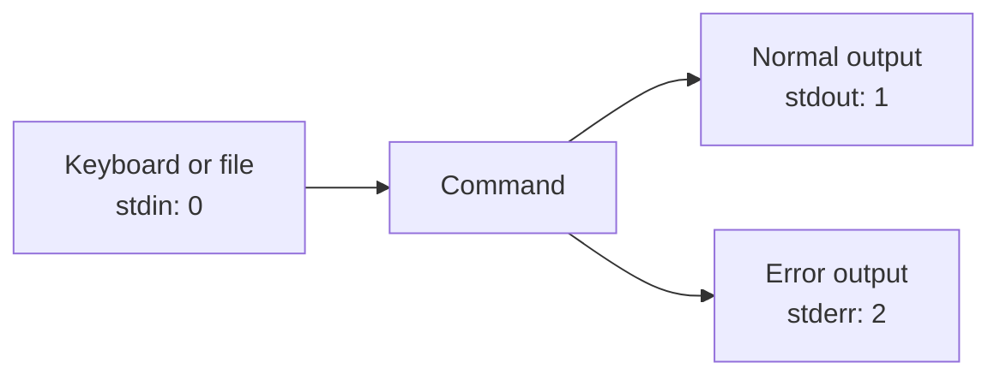

# Day 06 — Linux File Input, Output, Redirection, and Pipes

A safe, structured hands-on lab for practicing file creation, standard input, standard output, standard error, redirection operators, pipes, and `tee`.

> **Lab safety:** All practical exercises use a dedicated directory under your home directory. The original unrestricted sudoers example has been replaced with a security explanation because `NOPASSWD:ALL` grants full root access.

## Table of Contents

- [1. Learning Objectives](#1-learning-objectives)
- [2. Core Input and Output Concepts](#2-core-input-and-output-concepts)
- [3. Prepare the Lab Directory](#3-prepare-the-lab-directory)
- [4. Create and Inspect a File](#4-create-and-inspect-a-file)
- [5. Write with the Overwrite Operator](#5-write-with-the-overwrite-operator)
- [6. Append with the Append Operator](#6-append-with-the-append-operator)
- [7. Read File Content](#7-read-file-content)
- [8. Write and Display with tee](#8-write-and-display-with-tee)
- [9. Redirect Standard Input](#9-redirect-standard-input)
- [10. Redirect Standard Error](#10-redirect-standard-error)
- [11. Redirect Standard Output and Error Together](#11-redirect-standard-output-and-error-together)
- [12. Pipes Versus Redirection](#12-pipes-versus-redirection)
- [13. Practical Text-Processing Exercise](#13-practical-text-processing-exercise)
- [14. sudo and Redirection](#14-sudo-and-redirection)
- [15. sudoers Security Lesson](#15-sudoers-security-lesson)
- [16. Mini Challenge](#16-mini-challenge)
- [17. Verify and Clean Up](#17-verify-and-clean-up)
- [18. Common Mistakes](#18-common-mistakes)
- [19. Practice Questions](#19-practice-questions)
- [20. Quick Reference](#20-quick-reference)

---

## 1. Learning Objectives

After completing this lab, you should be able to:

1. Create and inspect files
2. Explain standard input, standard output, and standard error
3. Distinguish `>` from `>>`
4. Redirect input with `<`
5. Redirect errors with `2>`
6. Combine output streams safely
7. Explain the difference between a pipe and file redirection
8. Use `tee` to display and save output
9. Explain why `sudo echo ... > file` often fails
10. Recognize the security risk of unrestricted sudoers rules

---

## 2. Core Input and Output Concepts

Every Linux process normally starts with three standard data streams.

| File descriptor | Stream | Default destination or source |
|---:|---|---|
| `0` | Standard input (`stdin`) | Keyboard or another command |
| `1` | Standard output (`stdout`) | Terminal |
| `2` | Standard error (`stderr`) | Terminal |

### Simple data flow



### Why separate output streams?

Normal results and error messages can be handled independently. For example:

```bash
command >output.txt 2>errors.txt
```

- Normal output goes to `output.txt`.
- Error messages go to `errors.txt`.

---

## 3. Prepare the Lab Directory

Create a dedicated directory:

```bash
lab_dir="$HOME/linux-file-io-lab"
mkdir -p -- "$lab_dir"
cd -- "$lab_dir"
pwd
```

Expected path:

```text
/home/your-user/linux-file-io-lab
```

### Command explanation

| Part | Meaning |
|---|---|
| `lab_dir=...` | Stores the lab path in a shell variable |
| `mkdir -p` | Creates the directory; does not fail if it already exists |
| `--` | Marks the end of command options |
| `cd` | Changes into the lab directory |
| `pwd` | Displays the current working directory |

### Safety verification

```bash
test "$PWD" = "$lab_dir" &&
    echo "PASS: Working inside the lab directory"
```

Do not continue until the test prints `PASS`.

---

## 4. Create and Inspect a File

### Create an empty file

```bash
touch notes.txt
```

### Inspect it

```bash
ls -l notes.txt
```

Example output:

```text
-rw-r--r-- 1 user user 0 Nov 1 20:00 notes.txt
```

Your owner, group, permissions, date, and time may differ.

### Interpretation

| Field | Meaning |
|---|---|
| `-rw-r--r--` | File type and permissions |
| `user user` | Owner and group |
| `0` | File size in bytes |
| `notes.txt` | File name |

### Important `touch` behavior

- If the file does not exist, `touch` creates an empty file.
- If the file already exists, `touch` updates its timestamps.
- `touch` does not erase the existing contents.

Verify the file type:

```bash
file notes.txt
```

---

## 5. Write with the Overwrite Operator

### Write the first line

```bash
echo "This is line 1" > notes.txt
```

### Display the file

```bash
cat notes.txt
```

Expected output:

```text
This is line 1
```

### Meaning of `>`

`>` redirects standard output to a file.

- If the file does not exist, the shell creates it.
- If the file exists, the shell truncates it before writing.

### Demonstrate overwrite behavior

```bash
echo "Replacement line" > notes.txt
cat notes.txt
```

Expected output:

```text
Replacement line
```

The previous content is gone because `>` overwrote the file.

### Restore the first line

```bash
echo "This is line 1" > notes.txt
```

> Before using `>` with an important file, verify the destination carefully.

---

## 6. Append with the Append Operator

### Add a second line

```bash
echo "This is line 2" >> notes.txt
```

### Verify

```bash
cat notes.txt
```

Expected output:

```text
This is line 1
This is line 2
```

### Meaning of `>>`

`>>` appends standard output to the end of the file.

- Existing content remains.
- If the file does not exist, the shell creates it.

### Add two more lines

```bash
echo "This is line 3" >> notes.txt
echo "This is line 4" >> notes.txt
```

### Count the lines

```bash
wc -l notes.txt
```

Expected result:

```text
4 notes.txt
```

---

## 7. Read File Content

### Display the complete file

```bash
cat notes.txt
```

`cat` is useful for small text files. For large files, use `less`.

### Display the first two lines

```bash
head -n 2 notes.txt
```

Expected output:

```text
This is line 1
This is line 2
```

### Display the last two lines

```bash
tail -n 2 notes.txt
```

Expected output:

```text
This is line 3
This is line 4
```

### Number every line

```bash
nl -ba notes.txt
```

### View with a pager

```bash
less notes.txt
```

Press `q` to quit `less`.

---

## 8. Write and Display with tee

`tee` reads standard input and writes it to both standard output and one or more files.

### Overwrite a file with `tee`

```bash
printf '%s\n' "Alpha" "Beta" | tee tee-output.txt
```

You should see:

```text
Alpha
Beta
```

The same content is saved in `tee-output.txt`.

### Verify

```bash
cat tee-output.txt
```

### Append with `tee -a`

```bash
echo "Gamma" | tee -a tee-output.txt
```

### Verify again

```bash
cat tee-output.txt
```

Expected output:

```text
Alpha
Beta
Gamma
```

### Suppress tee's terminal copy

```bash
echo "Delta" | tee -a tee-output.txt >/dev/null
```

`tee` still writes to the file, but its standard output is redirected to `/dev/null`.

---

## 9. Redirect Standard Input

The `<` operator gives a file to a command as standard input.

### Count lines by passing a filename

```bash
wc -l notes.txt
```

Example:

```text
4 notes.txt
```

### Count lines through standard input

```bash
wc -l < notes.txt
```

Expected:

```text
4
```

Why is the filename missing? When the shell redirects the file into `wc`, `wc` receives data through standard input and is not given the filename as an argument.

### Sort through standard input

```bash
sort < tee-output.txt
```

---

## 10. Redirect Standard Error

### Produce a controlled error

```bash
ls file-that-does-not-exist
```

The error normally appears in the terminal.

### Save only the error

```bash
ls file-that-does-not-exist 2> errors.txt
```

### Inspect the captured error

```bash
cat errors.txt
```

### Append errors instead of overwriting

```bash
ls another-missing-file 2>> errors.txt
```

### File descriptor meaning

| Syntax | Meaning |
|---|---|
| `2>` | Redirect and overwrite standard error |
| `2>>` | Redirect and append standard error |

---

## 11. Redirect Standard Output and Error Together

### Separate normal and error output

```bash
ls notes.txt missing.txt >output.txt 2>errors.txt
```

Inspect both:

```bash
cat output.txt
cat errors.txt
```

### Send both streams to one file

Bash shorthand:

```bash
ls notes.txt missing.txt &>combined.txt
```

Portable form:

```bash
ls notes.txt missing.txt >combined.txt 2>&1
```

### Why order matters

Correct:

```bash
command >all-output.txt 2>&1
```

This first redirects stdout to the file, then points stderr to the same destination.

Different behavior:

```bash
command 2>&1 >all-output.txt
```

This first points stderr to the current stdout—normally the terminal—and then redirects only stdout to the file.

---

## 12. Pipes Versus Redirection

### Pipe

```bash
cat notes.txt | grep "line 2"
```

A pipe (`|`) sends one command's standard output to another command's standard input.

### File redirection

```bash
grep "line 2" notes.txt > matches.txt
```

Redirection sends output to a file.

### Cleaner form without unnecessary `cat`

```bash
grep "line 2" notes.txt
```

`grep` can read the file directly, so `cat` is not needed in this example.

### Compare

| Operator | Destination |
|---|---|
| `|` | Another command |
| `>` | A file, overwriting it |
| `>>` | A file, appending to it |
| `<` | A command's standard input |

---

## 13. Practical Text-Processing Exercise

Create a file with repeated values:

```bash
printf '%s\n' apple banana apple orange banana apple > fruits.txt
```

### Display the file

```bash
cat fruits.txt
```

### Sort it

```bash
sort fruits.txt
```

### Count unique values correctly

```bash
sort fruits.txt | uniq -c
```

Expected output:

```text
      3 apple
      2 banana
      1 orange
```

`uniq` compares adjacent lines, which is why `sort` normally comes first.

### Save the report

```bash
sort fruits.txt | uniq -c | tee fruit-report.txt
```

---

## 14. sudo and Redirection

### Why this commonly fails

```bash
sudo echo "text" > /root/example.txt
```

`sudo` elevates `echo`, but the current shell performs `>` before starting the command. If the shell does not have permission to open the destination, the command fails.

### Why this also does not elevate tee

```bash
sudo echo "text" | tee /root/example.txt
```

The pipe runs `sudo echo` and `tee` as separate commands. Only `echo` is elevated.

### Correct pattern when an administrative write is authorized

```bash
printf '%s\n' "text" | sudo tee /root/example.txt >/dev/null
```

For appending:

```bash
printf '%s\n' "more text" | sudo tee -a /root/example.txt >/dev/null
```

> Do not run these examples merely for practice on an important system. Use the home-directory lab for ordinary exercises, and write to protected paths only when the change is required and authorized.

---

## 15. sudoers Security Lesson

The original exercise used:

```text
khan ALL=(ALL) NOPASSWD:ALL
```

This rule means:

- User `khan` can run commands as any user
- All commands are allowed
- No password is required
- In practice, the user has unrestricted root-level control

This is not an appropriate general file-I/O practice exercise.

### Why direct writing is risky

```bash
echo "khan ALL=(ALL) NOPASSWD:ALL" | tee /etc/sudoers.d/khan
```

Problems:

- A regular user cannot normally write to `/etc/sudoers.d`
- It attempts to grant unrestricted privilege
- It does not validate sudoers syntax
- It may use incorrect ownership or permissions
- A syntax mistake can disrupt `sudo`

### Correct administration method

When a real, approved sudo rule is required, edit it with:

```bash
sudo visudo -f /etc/sudoers.d/khan
```

`visudo` validates syntax before saving.

Afterward, verify all sudoers files:

```bash
sudo visudo -c
```

Inspect permissions:

```bash
sudo stat -c '%A %a %U:%G %n' /etc/sudoers.d/khan
```

Typical sudoers drop-in permissions are:

```text
-r--r----- 440 root:root
```

### Least-privilege principle

Grant only:

- The required user or group
- The required target account
- The specific approved command
- Passwordless execution only when justified

Do not grant `NOPASSWD:ALL` for convenience.

---

## 16. Mini Challenge

Complete these tasks without looking at the answer first:

1. Create `students.txt`.
2. Write `Ali` as the first line.
3. Append `Khalid` and `Sara`.
4. Display the first two lines.
5. Display the last line.
6. Sort the names and save them in `students-sorted.txt`.
7. Display and save the line count using `tee`.
8. Redirect an intentional `ls` error to `challenge-errors.txt`.

### Suggested solution

```bash
touch students.txt
echo "Ali" > students.txt
echo "Khalid" >> students.txt
echo "Sara" >> students.txt
head -n 2 students.txt
tail -n 1 students.txt
sort students.txt > students-sorted.txt
wc -l students.txt | tee students-count.txt
ls missing-challenge-file 2> challenge-errors.txt
```

### Verify generated files

```bash
ls -lh students.txt students-sorted.txt students-count.txt challenge-errors.txt
```

---

## 17. Verify and Clean Up

### Review the lab directory

```bash
pwd
find . -maxdepth 1 -type f -printf '%f\n' | sort
```

### Review file sizes

```bash
du -ah .
```

### Keep the files for revision

No cleanup is required if you want to preserve the lab.

### Optional interactive cleanup

First move out of the directory:

```bash
cd -- "$HOME"
```

Confirm the exact target:

```bash
printf 'Cleanup target: %s\n' "$lab_dir"
```

Remove it interactively:

```bash
rm -ri -- "$lab_dir"
```

The `-i` option asks for confirmation. Verify that `lab_dir` contains the expected home-directory path before approving removal.

Clear the variable:

```bash
unset lab_dir
```

---

## 18. Common Mistakes

### Using `>` when you meant `>>`

`>` overwrites. `>>` appends.

### Assuming `touch` always creates a new file

If the file exists, `touch` updates its timestamps.

### Mixing stdout and stderr unintentionally

Normal output is descriptor 1; errors are descriptor 2.

### Putting redirections in the wrong order

`>file 2>&1` and `2>&1 >file` do not mean the same thing.

### Using unnecessary `cat`

Many commands, such as `grep`, `sort`, and `wc`, can read a file directly.

### Believing `sudo` automatically elevates the entire pipeline

Each pipeline component is a separate command. Elevation applies only where `sudo` is placed.

### Editing sudoers with ordinary redirection

Use `visudo` so syntax is validated.

### Practicing as root

Use a regular account and a dedicated directory under `$HOME`. Elevate only the exact command that requires it.

---

## 19. Practice Questions

### Questions

1. What are file descriptors 0, 1, and 2?
2. What is the difference between `>` and `>>`?
3. Why does `wc -l < notes.txt` omit the filename?
4. What does `2>` redirect?
5. What does `2>&1` mean?
6. Why does redirection order matter?
7. What is the difference between `|` and `>`?
8. What does `tee -a` do?
9. Why can `sudo echo text > protected-file` fail?
10. Why is `NOPASSWD:ALL` dangerous?

### Answer Key

1. Standard input, standard output, and standard error.
2. `>` overwrites; `>>` appends.
3. `wc` receives the data through stdin and was not given a filename argument.
4. Standard error, file descriptor 2.
5. It points standard error to the current destination of standard output.
6. The shell applies redirections from left to right.
7. A pipe sends output to another command; `>` sends output to a file.
8. It displays input and appends it to the specified file.
9. The current shell, not `sudo echo`, opens the redirection destination.
10. It allows the user to run any command as any user without a password.

---

## 20. Quick Reference

| Syntax | Purpose |
|---|---|
| `command > file` | Send stdout to a file and overwrite it |
| `command >> file` | Append stdout to a file |
| `command < file` | Use a file as stdin |
| `command 2> file` | Send stderr to a file and overwrite it |
| `command 2>> file` | Append stderr to a file |
| `command > file 2>&1` | Send stdout and stderr to one file |
| `command &> file` | Bash shorthand for combined output |
| `command1 | command2` | Pipe stdout into another command |
| `command | tee file` | Display output and overwrite a file |
| `command | tee -a file` | Display output and append to a file |
| `>/dev/null` | Discard standard output |
| `2>/dev/null` | Discard standard error |

### Final command summary

```bash
# Lab setup
lab_dir="$HOME/linux-file-io-lab"
mkdir -p -- "$lab_dir"
cd -- "$lab_dir"

# Create, overwrite, and append
touch notes.txt
echo "This is line 1" > notes.txt
echo "This is line 2" >> notes.txt

# Read
cat notes.txt
head -n 1 notes.txt
tail -n 1 notes.txt
wc -l notes.txt

# tee
echo "Alpha" | tee tee-output.txt
echo "Beta" | tee -a tee-output.txt

# Errors
ls missing-file 2>errors.txt

# Combined output
ls notes.txt missing-file >combined.txt 2>&1

# Pipe
sort fruits.txt | uniq -c | tee fruit-report.txt
```

## Final Takeaway

Linux redirection becomes easier when you remember the three streams:

- `0`: input
- `1`: normal output
- `2`: error output

Then decide where each stream should go: the terminal, a file, another command, or `/dev/null`.
